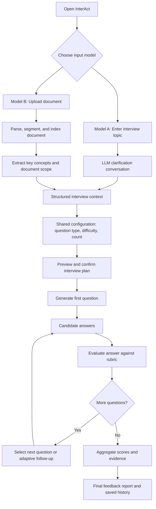
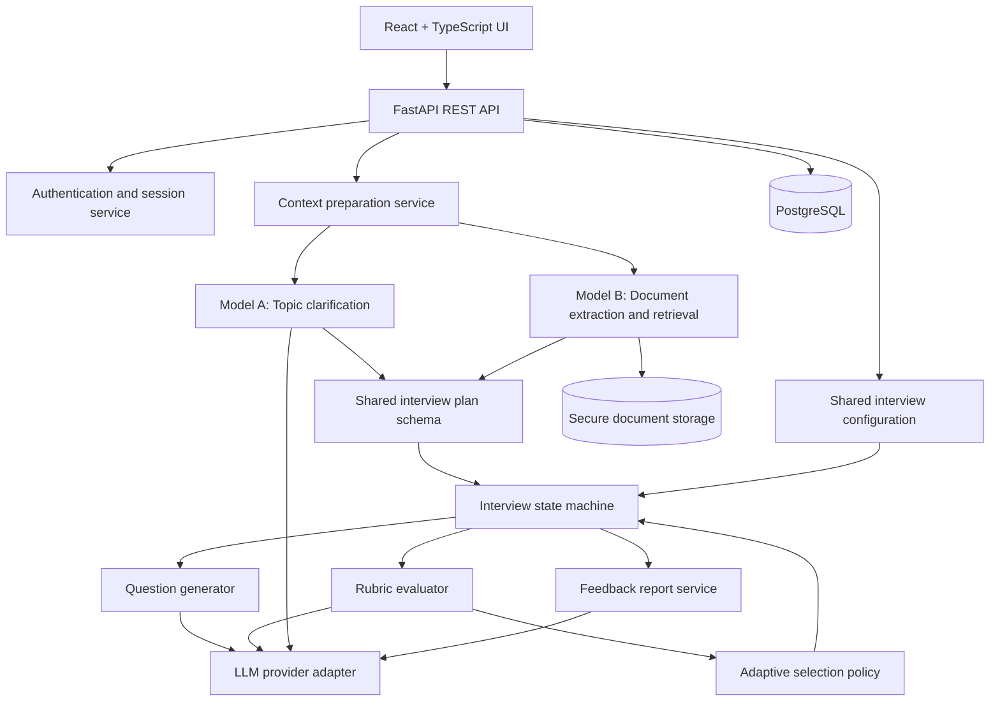
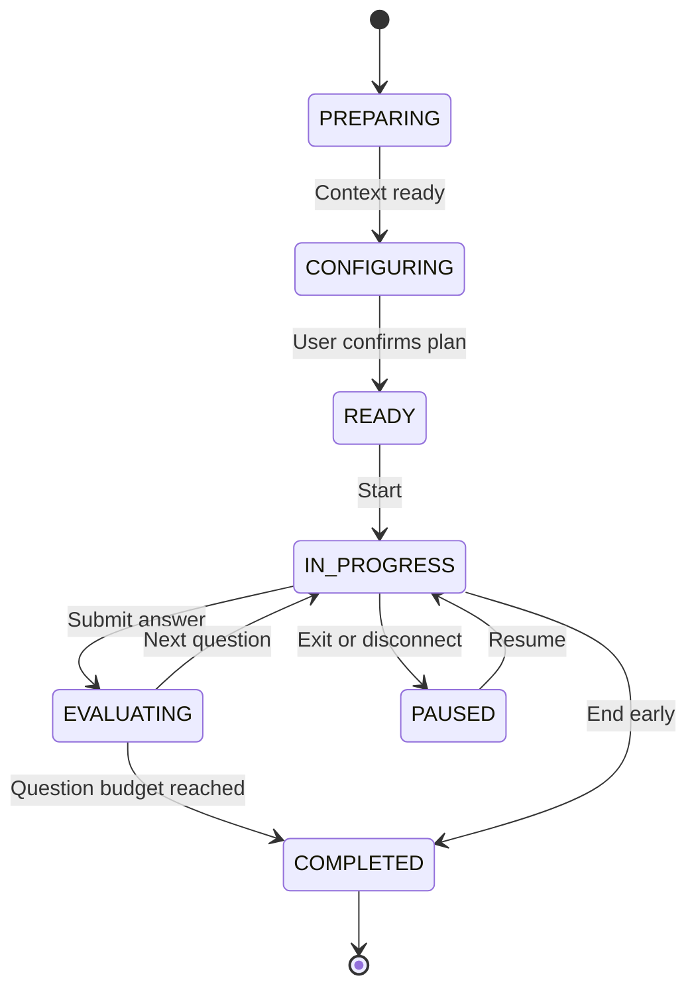

# InterAct

**An AI-powered, configurable interview practice platform with topic-based and document-grounded interviews, adaptive follow-ups, and evidence-based feedback.**

> **Project status:** Planned capstone — this README is a proposed technical specification, not documentation of an already implemented system.
>
> **Team:** 4 developers | **MVP timeline:** 15 days (primary developer, ~2–4 h/day) | **Focus:** Applied AI/ML research + full-stack software engineering
>
> The MVP scope is defined in [§9 — 15-day MVP roadmap](#9-15-day-mvp-roadmap). Anything not listed there is a future extension.

## 1. Product overview
InterAct allows a user to prepare for an interview in **exactly two ways**:

- **Model A — Topic-Based Interview:** The user describes what they want to be interviewed on in natural language. An LLM conducts a short **pre-interview clarification conversation** to establish the topic boundaries, goals, experience level, and relevant subtopics.
- **Model B — Document-Based Interview:** The user uploads a supported document. The platform extracts and organizes its content, then creates an interview grounded in that document. The user can review the identified topics and adjust the scope before proceeding.

**Question-style selection is not a third model.** Both models lead into the same configuration screen, where the user chooses direct, conceptual, case-based, scenario-based, application/problem-solving, or mixed questions, along with difficulty and question count. Both models then use the **same interview engine, scoring pipeline, and reporting system**.

### Product objectives

1. Make interview preparation flexible for technical, academic, and general subjects.
2. Let users specify interview goals conversationally or through a source document.
3. Generate questions consistent with the chosen style and difficulty.
4. Adapt follow-up questions to prior responses while maintaining topic coverage.
5. Provide actionable, evidence-based feedback rather than unsupported scores.
6. Evaluate the system scientifically against a fixed-question baseline.

**Positioning:** InterAct is an interview *practice and formative assessment* tool, not a validated automated hiring system. It should not make employment decisions or infer personality, emotion, or employability from facial or vocal cues.

---

## 2. User experience and functional flow



### 2.1 Model A — Topic-based interview

**Example user prompt:**

> Interview me on machine learning, especially cross-validation, overfitting, and evaluating classification models. I'm preparing for an ML internship.

**Sequence:**

1. User enters a free-form topic/prompt.
2. Backend creates a draft interview session in `PREPARING` state.
3. Preparation LLM extracts tentative topic, subtopics, goal, and skill level.
4. LLM asks **only the necessary clarification questions** (e.g., target level, interview purpose, subtopic emphasis). User may skip optional questions.
5. User replies conversationally; backend updates a **structured interview context**, not just a raw chat transcript.
6. LLM summarizes the agreed scope and hands off to shared configuration.
7. User selects question style and other settings, previews the plan, and confirms.
8. Interview begins.

**Preparation chat rules:** Limit to approximately 2–4 useful clarifications; avoid repeated questions; permit edits to the proposed scope; never begin the interview without explicit user confirmation. The preparation LLM acts as a planner, not the interviewer.

### 2.2 Model B — Document-based interview

**Supported formats:** The MVP supports text-based PDF and TXT. DOCX and PPTX are future extensions. Scanned PDFs require OCR and are rejected in the MVP with a clear message.

**Sequence:**

1. User uploads a document.
2. Backend validates extension, MIME/content type, size, and extraction limits; stores it securely.
3. Document ingestion extracts text and available page/slide/section metadata.
4. System segments the text into retrievable chunks with source references.
5. LLM extracts topics, learning objectives, and candidate interview scope **from the source**.
6. UI shows a document summary and detected topics for user review.
7. User optionally selects chapters/sections or clarifies focus.
8. User proceeds to the **same shared interview configuration** used in Model A.
9. Question generator retrieves relevant source chunks and produces document-grounded questions with source references.
10. Interview begins and final feedback distinguishes **document-supported claims** from outside knowledge.

**Grounding requirements:** A generated document-based question must be traceable to a source chunk. Retain file ID and page/slide/section metadata where available. Do not invent citations. If source content is missing or insufficient, state the limitation and ask the user to broaden scope or upload a better source.

### 2.2.1 Document grounding pipeline (MVP)

Typical inputs are lecture notes or chapters (roughly 5–60 pages), so the MVP uses a topic map plus lexical retrieval instead of a vector database.

1. **Page-aware chunking:** Extract text per page and split into chunks of roughly 400–800 tokens with small overlap. Each chunk stores `document_id`, `chunk_index`, and `page`.
2. **Topic map at ingestion:** The LLM groups chunks into topics (`topic → [chunk_ids]`). The user reviews and selects topics. Questions for a competency use its mapped chunks, so every citation comes from a known chunk.
3. **BM25 fallback retrieval:** For follow-ups or focus areas not covered by the map, rank the document's chunks with BM25 in application code. This is database-independent; pgvector/embeddings are a future option if lexical retrieval proves insufficient.
4. **Supporting-quote verification:** The generator returns a `supporting_quote` per question; the backend checks that it is a normalized substring of the cited chunk and regenerates or flags the question otherwise. The pass rate is reported as a grounding metric.
5. **Grounded answer key:** When a document question is generated, a short answer key is derived from the same chunks. The evaluator scores against it, which lets the report separate document-supported points from outside knowledge.
6. **Small-document shortcut:** If the selected scope is small enough to fit in the model context (≈15k tokens), scope extraction reads it whole instead of retrieving.
7. **Prompt-injection handling:** Document text is passed only inside delimited data blocks, never as instructions, and all LLM outputs are validated against strict schemas.

### 2.3 Shared interview configuration (both models)

| Setting | Choices / behavior |
|---|---|
| Question type | Direct/factual; conceptual; case-based; scenario-based; application/problem-solving; mixed |
| Difficulty | Beginner; intermediate; advanced |
| Question count | Suggested MVP: 5, 10, or 15 |
| Adaptive follow-ups | On by default; user may disable |
| Feedback timing | End-of-interview by default |
| Topic coverage | Display proposed competencies/subtopics before confirmation |
| Source constraint | In Model B, questions should be grounded in the uploaded document |

**Question types:**

- **Direct/factual:** “Define overfitting.”
- **Conceptual:** “Why can cross-validation provide a better estimate than one train/test split?”
- **Case-based:** “A model achieves 98% accuracy on a highly imbalanced dataset. Diagnose the result.”
- **Scenario-based:** “Your deployed model begins underperforming after a data pipeline change. What do you investigate?”
- **Application/problem-solving:** “Design an evaluation strategy for an imbalanced binary classifier.”
- **Mixed:** Selects across types using an explicit mix policy.

**Enforcement:** Store `question_type` in the session configuration and on every generated question. Validate question output against the requested style using schema checks and an optional lightweight LLM classifier. Regenerate or flag mismatches. A case-based question should include a concrete case; a scenario-based question should include a situation and decision constraints.

### 2.4 Live interview

1. The system presents **one question at a time**.
2. The user submits a text answer.
3. The evaluator returns structured scores, evidence from the answer, missing concepts, and uncertainty.
4. The interview state is updated with covered competencies, difficulty, question count, and recent performance.
5. The adaptive policy selects the next subtopic and question intent. The generator creates the next question within the **user-selected style**.
6. Repeat until the configured question budget is exhausted or the user ends the session.
7. Aggregate the rubric scores and generate the final report.

**Important:** Follow-up questions count toward the configured question budget unless the product explicitly offers a separate follow-up allowance. The MVP uses the same question budget in fixed and adaptive experiments.

### 2.5 Final feedback report

- Overall practice score (clearly labeled as a rubric-based estimate).
- Per-competency scores and coverage.
- Per-question response, score, explanation, and answer-grounded evidence.
- What the user answered correctly and what was missing.
- Suggested better-answer outline and areas to revise.
- For Model B: relevant source page/slide/section references where reliably available.
- Interview configuration, duration, and question history.
- Limitations/uncertainty notices when the answer or source does not support a confident assessment.

---

## 3. Proposed technical architecture

**Approach:** Modular monolith. A React frontend communicates with one FastAPI backend. The backend contains separate modules for ingestion, preparation, orchestration, generation, scoring, and reporting. PostgreSQL persists sessions and experiments. Avoid microservices and unnecessary multi-agent complexity during the MVP.



### Suggested technology stack

| Component | Technology | Responsibility |
|---|---|---|
| Frontend | React + TypeScript + Vite + Tailwind CSS | Preparation chat, upload UI, configuration, interview, report |
| Backend | Python 3.13 + FastAPI + Pydantic | API endpoints, validation, session lifecycle |
| Orchestration | Explicit Python state machine (no agent framework) | Deterministic state transitions and conditional follow-ups |
| LLM | OpenAI-compatible adapter; local and hosted modes | Clarification, extraction, generation, scoring, feedback |
| Authentication | Google and GitHub OAuth (Authlib) + secure HTTP-only session cookie | Sign-in, resource ownership |
| Database | PostgreSQL + SQLAlchemy + Alembic | Persistent users, sessions, answers, scores, research metadata |
| Document parsing | PyMuPDF (PDF), plain text (TXT) | Source extraction with page metadata |
| Retrieval | Topic map + BM25 in application code; optional pgvector later | Retrieve relevant document chunks |
| Tests | pytest (with a deterministic fake LLM), API integration tests, frontend build/lint | Reliability and regression coverage |
| Deployment | Free-tier hosting + managed PostgreSQL (e.g., Neon) | Hosted demo |

### LLM modes

Both modes use the same adapter because Ollama and common hosted providers expose an OpenAI-compatible API. Switching is configuration only (`LLM_BASE_URL`, `LLM_MODEL`, `LLM_API_KEY`).

| Mode | Provider | Used for |
|---|---|---|
| **Local** | Ollama with a ≤8B instruct model (e.g., Qwen3 8B, Llama 3.1 8B) | Development, offline use, reproducible experiments; no cost and no data leaves the machine |
| **Hosted** | A free-tier OpenAI-compatible provider (e.g., Groq, Gemini, OpenRouter) | The deployed demo, where a local model cannot run |

The model is chosen by measuring structured-output validity and grading quality on InterAct's own tasks. Free-tier limits change, so they are re-checked before the demo. Automated tests use a deterministic fake provider and never call a real model.

### Authentication

- Users sign in with Google or GitHub. No passwords are stored.
- The backend completes the OAuth flow and issues an HTTP-only, signed session cookie; no tokens are stored in frontend code.
- Only minimal profile data is stored: provider, provider user ID, email, display name.
- Every session, document, job, and avatar row has an `owner_id`, and all endpoints check ownership.
- OAuth client secrets live only in server-side environment variables.

### Why use a single shared interview engine?

The **input model only changes how context is prepared**. Once `InterviewContext` exists, both Model A and Model B share identical configuration, question generation, answer submission, scoring, and report code. This prevents duplicated logic and makes it easier to test question styles across both input models.

---

## 4. Core data contracts

The following are **illustrative proposed schemas**, not implemented interfaces.

### InterviewContext

```json
{
  "session_id": "uuid",
  "input_model": "TOPIC",
  "topic": "Machine Learning Model Evaluation",
  "goal": "ML internship practice",
  "level": "intermediate",
  "subtopics": ["cross-validation", "overfitting", "classification metrics"],
  "document_id": null,
  "source_references": []
}
```

For Model B, `input_model` is `DOCUMENT`, `document_id` identifies the uploaded source, and a `selected_topic_ids` list records the topics the user chose from the topic map.

### InterviewConfig

```json
{
  "question_type": "CASE_BASED",
  "difficulty": "intermediate",
  "question_count": 10,
  "adaptive": true,
  "feedback_timing": "END",
  "avatar_key": "preset-01"
}
```

Suggested question type enum: `DIRECT`, `CONCEPTUAL`, `CASE_BASED`, `SCENARIO_BASED`, `APPLICATION`, `MIXED`.

`avatar_key` names a preset interviewer and defaults to the user's `default_avatar_key`. The interview engine never reads it; only the UI uses it.

### GeneratedQuestion

```json
{
  "question_id": "uuid",
  "session_id": "uuid",
  "sequence": 1,
  "type": "CASE_BASED",
  "competency": "classification evaluation",
  "difficulty": "intermediate",
  "prompt": "A classifier has 98% accuracy but detects few positive cases. How would you evaluate it?",
  "rubric_id": "uuid",
  "source_chunk_ids": [],
  "supporting_quote": null,
  "answer_key": null,
  "grounding_status": "NOT_APPLICABLE"
}
```

`supporting_quote`, `answer_key`, and `grounding_status` apply to Model B. `grounding_status` is `VERIFIED`, `FLAGGED`, or `NOT_APPLICABLE`. The API must not return `answer_key` or `supporting_quote` until the question has been answered, because either one can reveal the answer.

### AnswerEvaluation

```json
{
  "question_id": "uuid",
  "score": 3,
  "max_score": 5,
  "criteria": [
    {
      "name": "metric selection",
      "score": 2,
      "max_score": 3,
      "evidence_quote": "I would examine recall and precision",
      "reason": "Relevant metrics identified, but trade-offs were not explained"
    }
  ],
  "missing_concepts": ["precision-recall trade-off"],
  "insufficient_evidence": false
}
```

**Validation:** Ensure scores fall within rubric bounds; evidence quotes must be verifiable substrings of the submitted answer or explicitly marked as paraphrases; do not present LLM-generated rationales as observed candidate statements.

---

## 5. Interview state machine



**Backend rules:**

- A session must not start until a valid `InterviewContext` and `InterviewConfig` are confirmed.
- Only one unanswered active question should exist per session.
- Answer submission should be idempotent to avoid duplicate questions or scores.
- Persist state before acknowledging completed operations.
- On LLM errors, retry safely within limits; do not silently fabricate scores.
- If evaluation still fails after retries, keep the saved answer and leave the session in `EVALUATING`. Resubmitting the same answer retries evaluation without creating a duplicate; submitting different text for that question is rejected.
- Keep raw model output separate from validated structured data.
- Uploaded document text and user answers are untrusted inputs; they must not override system instructions or rubric rules.

### Adaptive policy (MVP)

Use a transparent rule-based policy instead of training a separate model:

1. Track coverage of each planned competency.
2. Evaluate the latest answer using the same rubric as the fixed baseline.
3. If evidence is incomplete and follow-ups are enabled, select a clarifying/deeper question within the same competency.
4. Otherwise, move to the least-covered planned competency.
5. Maintain the selected question style and difficulty bounds.
6. Respect the question budget and avoid repeating questions.

Keep **fixed-question mode** available internally for controlled research comparisons. Adaptive mode is a user-facing configuration option, not a third input model.

---

## 6. Proposed API endpoints

| Method | Endpoint | Purpose |
|---|---|---|
| `POST` | `/api/v1/sessions` | Create draft session for `TOPIC` or `DOCUMENT` |
| `POST` | `/api/v1/sessions/{id}/prepare/message` | Exchange Model A clarification messages |
| `POST` | `/api/v1/documents` | Upload and validate a document |
| `GET` | `/api/v1/documents/{id}/summary` | Return extracted topics and source summary |
| `PUT` | `/api/v1/sessions/{id}/context` | Update/confirm prepared scope |
| `PUT` | `/api/v1/sessions/{id}/config` | Set common question style, difficulty, and count |
| `GET` | `/api/v1/sessions/{id}` | Fetch a session's state, context, and config for plan preview and resume |
| `POST` | `/api/v1/sessions/{id}/confirm` | Confirm the previewed plan; move `CONFIGURING` to `READY` |
| `POST` | `/api/v1/sessions/{id}/start` | Begin the interview; move `READY` to `IN_PROGRESS` |
| `GET` | `/api/v1/sessions/{id}/current-question` | Fetch active question |
| `POST` | `/api/v1/sessions/{id}/answers` | Submit answer and trigger evaluation |
| `POST` | `/api/v1/sessions/{id}/pause` | Move `IN_PROGRESS` to `PAUSED` |
| `POST` | `/api/v1/sessions/{id}/resume` | Move `PAUSED` to `IN_PROGRESS` and keep the active question |
| `POST` | `/api/v1/sessions/{id}/finish` | End session and generate report |
| `GET` | `/api/v1/sessions/{id}/report` | Fetch report |
| `GET` | `/api/v1/sessions` | List user's interview history |
| `GET` | `/api/v1/jobs/{id}` | Fetch the status and result of a background job |
| `GET` | `/api/v1/avatars/presets` | List preset interviewer avatars |
| `PUT` | `/api/v1/auth/me/default-avatar` | Save the user's default preset avatar |
| `GET` | `/api/v1/auth/{provider}/login` | Start Google or GitHub sign-in |
| `GET` | `/api/v1/auth/{provider}/callback` | Complete OAuth and set session cookie |
| `GET` | `/api/v1/auth/me` | Return the signed-in user |
| `POST` | `/api/v1/auth/logout` | Clear the session cookie |

All session/document/job endpoints must authorize access to the resource owner. Long LLM operations return a job ID that the client polls at `/api/v1/jobs/{id}`, rather than blocking indefinitely.

---

## 7. Proposed database entities

| Entity | Important fields |
|---|---|
| `users` | id, auth_provider (`google`/`github`), provider_user_id, email, display_name, default_avatar_key, created_at |
| `documents` | id, owner_id, filename, storage_key, status, summary_json, created_at |
| `document_chunks` | id, document_id, text, page/slide/section reference, chunk_index |
| `document_topics` | id, document_id, name, summary, chunk_ids |
| `sessions` | id, owner_id, input_model, state, context_json, config_json, created_at |
| `preparation_messages` | id, session_id, role, content, created_at |
| `rubrics` | id, version, name, criteria_json, max_score, created_at |
| `questions` | id, session_id, sequence, type, competency, prompt, rubric_id, source_chunk_ids, supporting_quote, answer_key_json, grounding_status |
| `answers` | id, question_id (unique), session_id, text, submitted_at |
| `evaluations` | id, answer_id (unique), scores_json, evidence_json, evaluator_version |
| `reports` | id, session_id, summary_json, generated_at |
| `jobs` | id, owner_id, kind, status, session_id, document_id, result_json, error_code, created_at, completed_at |
| `llm_calls` | id, session_id, document_id, purpose, model, prompt_version, raw_output, validation_status, created_at |
| `experiment_runs` | id, model_version, prompt_version, rubric_version, dataset_version, metrics_json |

**Ownership:** `owner_id` always references `users.id`. Rows without their own `owner_id` inherit ownership through their parent session or document. Rubrics are shared and have no owner; a rubric version is never edited once a question references it, so fixed and adaptive runs stay comparable.

**Jobs:** `status` follows `QUEUED → PROCESSING → COMPLETED`, or `FAILED` with an `error_code`.

**Raw LLM output:** `llm_calls` keeps the unmodified model response, separate from the validated data in `questions`, `evaluations`, and `reports`.

**Preset avatars:** Presets are a static list in the application, identified by a key, so the MVP needs no avatar tables. `users.default_avatar_key` stores the saved choice.

Store minimal personal information. Set retention/deletion rules for uploaded files and answers. Research datasets should be synthetic or explicitly consented and de-identified where appropriate.

---

## 8. AI/ML research and evaluation

### Primary research question

**Does adaptive question selection improve question relevance and competency coverage over fixed-question interviewing, while maintaining acceptable score agreement with human ratings?**

### Experimental design

- **Baseline:** fixed sequence of questions.
- **Treatment:** adaptive follow-up selection.
- **Controlled variables:** same LLM provider/model version, rubric, target topic, question-style setting, difficulty, and question budget.
- **Dataset target:** approximately 60–100 answer instances if feasible, with independently human-rated examples; reduce target rather than compromise annotation quality.
- **Metrics:** human-vs-AI score MAE, appropriate ordinal agreement (e.g., weighted Cohen's kappa), question relevance, competency coverage, evidence support rate, repeat-score variance, latency, and cost.
- **Document-grounding test:** human-check whether generated questions and cited source references are actually supported by uploaded content.
- **Reporting:** publish sample sizes, uncertainty, limitations, and failures, not only favorable examples.

Do not claim that the adaptive system is superior until experimental results support that conclusion. Maintain separate development and evaluation examples to reduce overfitting to the benchmark.

---

## 9. 15-day MVP roadmap

Budget: about 30–60 hours. Each milestone ends with passing tests and a reviewable pull request.

| # | Milestone | Exit criteria |
|---|---|---|
| **M0** | Scope and README update | Spec matches the realistic MVP |
| **M1** | Backend skeleton, PostgreSQL models with `owner_id`, shared interview state machine on a fake LLM | A full session runs through the API in tests |
| **M2** | OpenAI-compatible LLM adapter (Ollama), style-aware question generation, rubric evaluator, local model comparison | Real questions and validated evaluations from a local model |
| **M3** | Frontend flow: topic input → configuration → interview → report | End-to-end interview in the browser (Model A, no clarification yet) |
| **M4** | Google and GitHub sign-in | Only the owner can access their sessions |
| **M5** | Model A clarification conversation | Skippable 2–4 question clarification produces a confirmed context |
| **M6** | Model B: PDF/TXT ingestion, topic map, BM25 retrieval, grounding checks | Document-grounded interview with verified source references |
| **M7** | Adaptive follow-ups, preset avatars, deployment (managed PostgreSQL + hosted LLM mode) | Deployed demo with fixed and adaptive modes |

**Scope protection:** Text-only interview is the MVP. Voice, video, emotion detection, arbitrary code execution, custom model training, DOCX/PPTX parsing, and AI avatar generation are out of scope for the MVP. A small fixed-vs-adaptive comparison is kept; the larger human-rated study in §8 is run only as time allows, with its sample size reported honestly.

### Team allocation

| Owner | Responsibility |
|---|---|
| **Member 1 — AI planning & orchestration** | Model A clarification, interview context, question generation, question-style enforcement, adaptive policy |
| **Member 2 — Document intelligence & research** | Model B parsing/grounding, scoring rubric, dataset, human evaluation, experiment analysis |
| **Member 3 — Backend & data** | FastAPI, PostgreSQL, APIs, authentication, session state, persistence, backend tests |
| **Member 4 — Frontend & deployment** | React UX, upload/chat/config/interview/report screens, frontend tests, Docker and hosting |

All members collaborate on API contracts, integration, end-to-end tests, and documentation.

---

## 10. Acceptance criteria

### Product

- [ ] Model A supports free-form topic input and short, skippable LLM clarification.
- [ ] Model B accepts at least text-based PDFs and extracts traceable source content.
- [ ] Both models converge into one shared question-style configuration screen.
- [ ] Direct, conceptual, case-based, scenario-based, application, and mixed questions are supported.
- [ ] User confirms the interview plan before the first question.
- [ ] Interview progresses one question at a time with persisted answers.
- [ ] Adaptive follow-ups preserve the selected question style and topic scope.
- [ ] Final report includes scores, answer evidence, and actionable suggestions.

### Engineering and research

- [ ] Sessions resume safely and reject duplicate answer submissions.
- [ ] API and integration tests cover the critical interview journey.
- [ ] Document access is authorized; secrets and uploads are protected.
- [ ] Fixed and adaptive experiments use documented comparable settings.
- [ ] Human-rated benchmark and evaluation scripts are reproducible.
- [ ] App is deployed with setup instructions and a recorded fallback demo.
- [ ] Final report clearly distinguishes verified results from limitations.

---

## 11. Repository layout (proposed)

```text
interact/
├── frontend/
│   └── src/
│       ├── pages/           # Input, preparation, configuration, interview, report
│       ├── components/
│       └── api/
├── backend/
│   ├── app/
│   │   ├── api/             # REST routes
│   │   ├── schemas/         # Pydantic contracts
│   │   ├── models/          # Database entities
│   │   ├── services/
│   │   │   ├── preparation.py
│   │   │   ├── document_ingestion.py
│   │   │   ├── question_generation.py
│   │   │   ├── adaptive_policy.py
│   │   │   ├── evaluation.py
│   │   │   └── reporting.py
│   │   └── core/            # Auth, configuration, provider adapter
│   └── tests/
├── research/
│   ├── datasets/
│   ├── annotation_guidelines.md
│   ├── experiments/
│   └── analysis/
├── docs/
│   ├── architecture.md
│   └── api.md
├── docker-compose.yml
└── README.md
```

## 12. Demo scenarios

**Scenario A — Topic-based:** “Interview me on operating systems for a software engineering internship.” The AI clarifies focus, user selects scenario-based questions, and the interviewer asks situational OS questions followed by targeted follow-ups.

**Scenario B — Document-based:** User uploads a lecture PDF on database normalization, selects case-based questions, and receives questions tied to the uploaded material, followed by an evidence-based feedback report.

**Scenario C — Research demonstration:** Run the same competency plan in fixed and adaptive modes; show question histories, coverage differences, score agreement, and limitations from the benchmark.

---

## 13. Future extensions (not MVP commitments)

- Voice input/output and speech transcription.
- Coding interviews with isolated execution and automated test cases.
- User-selectable feedback timing and detailed progress trends.
- Multilingual interview support.
- Larger-scale controlled studies with more participants and domains.

---

## 14. Contributing and status

This repository is intended for a four-person academic capstone. Contributors should agree on data contracts and interface ownership before implementation. Use feature branches, pull-request reviews, automated tests, and versioned research configurations.

**Current state:** MVP scope agreed (see §9); frontend scaffold (React + TypeScript + Vite + Tailwind CSS) exists; backend, LLM integration, and benchmark results are pending. Replace this status section with verified setup commands, screenshots, demo URL, actual experiment results, and individual contributions as development progresses.


## Custom AI Interviewer Studio

### Overview

InterAct allows users to personalize their interview experience by selecting a predefined AI interviewer, creating a custom interviewer through natural-language prompts, or uploading an image as a visual reference.

The Custom AI Interviewer Studio makes the interviewer a configurable part of the product while keeping its visual appearance independent of the underlying interview intelligence.

### Core Features

#### 1. Default Interviewer Library
- Provide a curated collection of predefined interviewer avatars.
- Support different appearances, visual styles, and professional personalities.
- Allow users to preview and select an interviewer before starting an interview.
- Allow users to save a preferred avatar as their default interviewer.

#### 2. Prompt-to-Avatar Generation
- Users describe their desired interviewer through a chat interface.
- The backend converts the description into a structured image-generation prompt.
- Users can specify appearance, clothing, expression, visual style, and background.
- A configured image-generation provider generates the avatar.
- Users can refine the description, regenerate the avatar, and save the final result.

**Example prompt:**

> Create a friendly, confident interviewer wearing a navy-blue suit, with a calm and professional expression. Use realistic proportions, soft studio lighting, a clean background, and a centered head-and-shoulders composition.

#### 3. Image-Based Avatar Creation
- Users can upload an image of a person as a visual reference.
- The system validates the image format, size, and content before processing.
- A compatible image-generation provider uses the uploaded image as a reference to create an interviewer portrait.
- Users can preview and save the resulting avatar.
- Appropriate permission must be obtained before using a person's likeness.

#### 4. Avatar Library and Reuse
- Store custom avatars in the user's personal library.
- Allow users to view, select, rename, and delete saved avatars.
- Preserve avatar metadata and image references across sessions.
- Allow the selected avatar to be reused across multiple interviews.

### User Workflow

1. The user opens Interviewer Studio.
2. The user chooses a default avatar, describes a custom interviewer, or uploads a reference image.
3. InterAct validates the input and prepares the generation request.
4. The backend sends the request to the configured image-generation provider.
5. The user receives a preview and can regenerate or refine the result.
6. The user saves the avatar to their personal library.
7. The selected avatar is attached to the interview configuration.
8. The interview engine conducts the interview independently of the avatar generation process.

### Technical Architecture

The feature follows the existing modular-monolith architecture.

| Component | Responsibility |
|---|---|
| React + TypeScript | Avatar creation chat, image upload, preview, gallery, and selection |
| FastAPI | Input validation, authentication, generation lifecycle, and avatar management |
| Prompt Preparation Service | Converts user descriptions into structured image prompts |
| Image Provider Adapter | Integrates with a configured image-generation API |
| PostgreSQL | Stores avatar metadata, generation jobs, ownership, and status |
| Object Storage | Stores generated images and uploaded reference images |
| Interview Engine | Uses the selected avatar without coupling avatar generation to interview logic |

**Important:** Image generation must be integrated explicitly. The system must not assume that a provider is configured or return a successful result when the provider is unavailable.

### API Design

These endpoints support the future custom avatars. The MVP uses only the preset endpoints in §6.

| Method | Endpoint | Purpose |
|---|---|---|
| `POST` | `/api/v1/avatars/generations` | Start avatar generation from a text description |
| `GET` | `/api/v1/avatars/generations/{id}` | Retrieve generation status |
| `POST` | `/api/v1/avatars` | Save a generated avatar |
| `GET` | `/api/v1/avatars` | List the authenticated user's avatars |
| `GET` | `/api/v1/avatars/{id}` | Retrieve avatar metadata |
| `DELETE` | `/api/v1/avatars/{id}` | Delete an owned avatar and associated assets |
| `POST` | `/api/v1/avatars/uploads` | Upload a reference image |

The API must enforce authentication, ownership checks, input validation, and appropriate rate limits.

### Data Model

These tables support the future custom avatars. MVP presets are static and use none of them (see §7).

#### Avatar
- `id`
- `owner_id`
- `name`
- `description`
- `visual_style`
- `source_type` — `text_prompt` or `image_upload`
- `status`
- `created_at`
- `updated_at`

#### AvatarGeneration
- `id`
- `owner_id`
- `avatar_id`
- `prompt_version`
- `provider`
- `provider_job_id`
- `status`
- `error_code`
- `created_at`
- `completed_at`

#### AvatarAsset
- `id`
- `avatar_id`
- `storage_key`
- `mime_type`
- `width`
- `height`
- `created_at`

These are proposed entities to be implemented using the project's existing PostgreSQL and SQLAlchemy conventions.

### Generation Lifecycle

The avatar generation lifecycle follows these states:

`QUEUED → PROCESSING → COMPLETED`

If generation fails, the status becomes `FAILED`, and the frontend displays an actionable error.

Long-running generation requests should use background processing and a status endpoint rather than blocking an HTTP request indefinitely.

The prompt preparation service should use a versioned template to maintain consistent composition, framing, lighting, and visual quality. Provider-specific logic must remain isolated behind an adapter to avoid vendor lock-in.

### Frontend Integration

Suggested frontend structure:

```text
frontend/src/
├── pages/
│   └── InterviewerStudio.tsx
├── components/
│   └── avatars/
│       ├── AvatarCreationChat.tsx
│       ├── AvatarPreview.tsx
│       ├── AvatarCard.tsx
│       ├── AvatarGallery.tsx
│       └── AvatarGenerationStatus.tsx
└── api/
    └── avatars.ts
```

The frontend should support:
- Submitting an interviewer description.
- Uploading a reference image.
- Displaying generation progress and errors.
- Previewing and regenerating avatars.
- Saving and selecting avatars.
- Displaying saved avatars in the personal library.

### Security and Privacy

- Store API keys in server-side environment variables or a secrets manager.
- Never expose image-provider credentials to the frontend.
- Store images in private object storage and use authorized access or short-lived signed URLs.
- Validate file types, sizes, and actual image content.
- Enforce per-user access controls and generation rate limits.
- Apply retention and deletion policies to uploaded images and generated assets.
- Require appropriate permission for the use of a person's likeness.
- Handle provider errors and retries without creating inconsistent database records.

### Implementation Scope

#### MVP
- Curated default interviewer library (static preset images; no image generation).
- Select a preset avatar for an interview and save it as the user's default.
- Integration with the existing interview interface.

#### Future Enhancements
- Prompt-based avatar generation through an image-provider adapter.
- Avatar preview and regeneration.
- Save, select, and reuse custom avatars with persistent metadata and secure image storage.
- Graceful handling of unconfigured providers and failed requests.
- Image-reference-based avatar generation.
- Advanced appearance and outfit customization.
- Multiple avatar variations per prompt.
- Voice selection and synchronization.
- Facial animation, lip synchronization, and real-time talking avatars.

### Acceptance Criteria

MVP:

- [ ] Users can select a predefined avatar and save it as their default.
- [ ] The selected avatar integrates with the interview UI without modifying the core interview engine.

Future (custom avatars):

- [ ] Users can request a custom avatar.
- [ ] A configured provider generates real images from validated prompts.
- [ ] Users can preview, refine, save, and reuse custom avatars.
- [ ] Saved avatar metadata persists across sessions.
- [ ] Users cannot access or modify another user's private avatars.
- [ ] Provider failures produce clear error states.
- [ ] Uploaded and generated assets follow appropriate security and deletion policies.

### Design Principle

**The avatar defines how the interviewer looks; the interview engine defines how the interviewer thinks, asks questions, follows up, and evaluates answers.**

These systems must remain independently configurable.

## License

To be decided by the team before public release.


